# HỆ THỐNG QUẢN LÝ DỊCH VỤ KHÁCH SẠN (HOTEL SERVICE MANAGEMENT SYSTEM)

Hệ thống phần mềm máy tính chuyên biệt phục vụ công tác quản lý, điều hành và kinh doanh chuỗi **dịch vụ tại khách sạn** (Đồ ăn thức uống, Sảnh tiệc & Hội nghị, Cho thuê xe máy, Bãi giữ xe, Giặt ủi đối tác liên kết, Sơ đồ phòng & Tích hợp gộp hóa đơn thanh toán).

---

## MỤC LỤC
1. [Giới Thiệu Tổng Quan](#1-giới-thiệu-tổng-quan)
2. [Ngôn Ngữ & Công Nghệ Sử Dụng](#2-ngôn-ngữ--công-nghệ-sử-dụng)
3. [Kiến Trúc Ứng Dụng](#3-kiến-trúc-ứng-dụng)
4. [Chi Tiết Các Phân Hệ Chức Năng](#4-chi-tiết-các-phân-hệ-chức-năng)
5. [Tổ Chức Cơ Sở Dữ Liệu (Database Schema)](#5-tổ-chức-cơ-sở-dữ-liệu-database-schema)
6. [Sơ Đồ Quan Hệ Cơ Sở Dữ Liệu (ERD)](#6-sơ-đồ-quan-hệ-cơ-sở-dữ-liệu-erd)
7. [Các Ràng Buộc, Triggers & Stored Procedures](#7-các-ràng-buộc-triggers--stored-procedures)
8. [Hướng Dẫn Cài Đặt & Vận Hành](#8-hướng-dẫn-cài-đặt--vận-hành)
9. [Tài Khoản Đăng Nhập Mặc Định](#9-tài-khoản-đăng-nhập-mặc-định)

---

## 1. GIỚI THIỆU TỔNG QUAN

Khác với các phần mềm quản lý lưu trú thuần túy chỉ tập trung vào tiền phòng, **Hệ thống Quản lý Dịch vụ Khách sạn** được thiết kế chuyên sâu giải quyết bài toán:
- Tối ưu hóa doanh thu từ các nguồn dịch vụ ngoài tiền phòng.
- Cho phép khách thanh toán trực tiếp hoặc **Ghi nợ vào tiền phòng** để quyết toán một lần khi làm thủ tục trả phòng (Check-out).
- Phân định minh bạch trách nhiệm nhân sự: Tự động ghi vết **Người lập đơn ($T_1$)** và **Thu ngân thực thu ($T_2$)** dựa trên tài khoản đăng nhập thực tế (`admin` / `letan`) kết hợp lịch trực ca (Sáng / Chiều / Đêm).
- Hỗ trợ mô hình khách sạn vừa và nhỏ, giao diện hiện đại, dễ thao tác, có thanh ngăn linh hoạt và khả năng co giãn tốt trên cả màn hình lớn và laptop.

---

## 2. NGÔN NGỮ & CÔNG NGHỆ SỬ DỤNG

### 2.1. Nền tảng & Ngôn ngữ lập trình
- **Ngôn ngữ lập trình:** `C# 14` / `.NET 10.0` (Target Framework: `net10.0-windows`).
- **Giao diện người dùng (UI/UX):** `WPF` (Windows Presentation Foundation) kết hợp `XAML`.
- **Cơ chế thiết kế:** GitHub-style Modern Flat UI, Vector Icons, Dynamic Triggers, Data Binding hai chiều (`Two-Way Binding`).

### 2.2. Thư viện & Công nghệ phụ trợ
- **Mô hình kiến trúc phần mềm:** `MVVM` (Model - View - ViewModel) phân tách rõ ràng tầng giao diện, tầng nghiệp vụ và tầng dữ liệu.
- **Tầng truy cập dữ liệu (Data Access Layer):** `ADO.NET` thuần kết hợp thư viện chính thức `Microsoft.Data.SqlClient` (Version `7.0.2`), đảm bảo tốc độ phản hồi cực nhanh, sử dụng hoàn toàn `Parameterized Queries` và `Stored Procedures` phòng chống tấn công SQL Injection.
- **Hệ quản trị Cơ sở dữ liệu (DBMS):** `Microsoft SQL Server` (Hỗ trợ LocalDB, SQL Express, Standard hoặc Enterprise Server).
- **Cơ chế thời gian thực (Real-time Sync):** Kết hợp các sự kiện bộ nhớ (`INotifyPropertyChanged`, `ObservableCollection`, Custom Actions), bộ đếm thời gian ngầm (`DispatcherTimer`) định kỳ quét lịch biểu sự kiện, cảnh báo xe thuê, nhắc nhở trả đồ giặt và chuyển giao ca trực.

---

## 3. KIẾN TRÚC ỨNG DỤNG

```
QuanLyDichVuKhachSan/
│
├── QuanLyDichVuKhachSan_App/           # Thư mục chứa bản phát hành (Production Binary)
│   ├── QuanLyDichVuKhachSan.exe        # File thực thi chạy ứng dụng chính
│   ├── appsettings.json                # File cấu hình chuỗi kết nối Database
│   └── Chay_Ung_Dung.bat               # Script chạy nhanh ứng dụng
│
├── QuanLyDichVuKhachSan_Code/          # Thư mục mã nguồn dự án (Visual Studio Solution)
│   ├── Database/                       # Kịch bản SQL khởi tạo CSDL hoàn chỉnh
│   │   ├── 1_Table.sql                 # Cấu trúc bảng, Khóa chính, Khóa ngoại, Ràng buộc CHECK
│   │   ├── 2_Views.sql                 # Các View báo cáo, theo dõi trạng thái tức thời
│   │   ├── 3_Trigger.sql               # Các Trigger kiểm tra chống trùng lịch, tồn kho
│   │   ├── 4_Procedures.sql            # Các Stored Procedures nghiệp vụ và thanh toán
│   │   └── 5_Data.sql                  # Dữ liệu mẫu chuẩn nghiệp vụ khách sạn
│   ├── Models/                         # Định nghĩa thực thể dữ liệu (Room, Services, Staff, User...)
│   ├── ViewModels/                     # Xử lý Logic, Tính toán giá, Commands và Điều phối State
│   ├── Views/                          # Giao diện người dùng XAML và Dialog cửa sổ tương tác
│   ├── Services/                       # Tầng dịch vụ hệ thống:
│   │   ├── DatabaseService.cs          # Quản lý kết nối, tự động migration cột, chạy SQL Async
│   │   ├── DataService.cs              # Cache nghiệp vụ, tính toán tiền, xử lý logic thanh toán
│   │   ├── AuthService.cs              # Quản lý phiên làm việc, phân quyền Admin / Lễ tân
│   │   └── NotificationService.cs      # Giám sát kho và dịch vụ để gửi cảnh báo tự động
│   └── Resources/                      # Resource icons, hình ảnh, style templates
│
└── README.md                           # Tài liệu kỹ thuật chi tiết
```

---

## 4. CHI TIẾT CÁC PHÂN HỆ CHỨC NĂNG

### 4.1. Sơ đồ phòng & Quản lý lưu trú (Room Map & Stay Management)
- Hiển thị trực quan **25 phòng khách sạn** từ Tầng 1 đến Tầng 5 với 4 trạng thái mã màu: *Phòng trống*, *Đang ở*, *Chờ dọn dẹp*, *Bảo trì*.
- Thao tác nhanh: **Nhận phòng (Check-in)**, **Gia hạn lưu trú**, **Đổi phòng**.
- **Tính năng Gộp hóa đơn (Consolidated Billing):** Khi khách trả phòng, hệ thống tự động quét và gộp tất cả dịch vụ ghi nợ vào phòng (ăn uống, thuê xe, giặt ủi, sự kiện) hiển thị lên cùng một hóa đơn thanh toán duy nhất.
- **Tự động xuất bãi đỗ xe:** Khi khách phòng làm thủ tục trả phòng, hệ thống tự động giải phóng danh sách xe của phòng đó ra khỏi bãi đỗ xe.

### 4.2. Dịch vụ Ẩm thực & Minibar (Food & Beverage)
- Quản lý danh mục món ăn và thức uống phân theo loại (Món khai vị, Món chính, Đồ ăn nhanh, Nước giải khát, Bia/Rượu).
- Hỗ trợ 2 hình thức thanh toán: **Thanh toán trực tiếp** (Tiền mặt/Chuyển khoản) hoặc **Ghi nợ vào tiền phòng**.
- Kiểm soát tồn kho tự động: Trừ kho ngay khi hoàn tất đơn; tự động hoàn trả số lượng tồn kho nếu đơn bị hủy qua DB Trigger.
- In phiếu hóa đơn chi tiết món, số lượng, đơn giá và tiền thừa.

### 4.3. Quản lý Kho & Nhập hàng (Inventory Management)
- Quản lý thông tin nhà cung cấp thực phẩm/đồ uống.
- Tạo phiếu nhập kho: Tự động cập nhật số lượng tồn thực tế và giá vốn bình quân qua Trigger `trg_ChiTietPhieuNhapKho_CongTonKho`.
- Cảnh báo mặt hàng sắp hết tồn kho theo ngưỡng tối thiểu định trước.
- Báo cáo phân tích giá trị tồn kho và lợi nhuận gộp từng mặt hàng.

### 4.4. Dịch vụ Sảnh & Tổ chức Sự kiện (Event & Conference Spaces)
- Danh mục khu vực sự kiện với quy mô vừa phải, hợp lý:
  - **Sảnh Đại Tiệc A:** Sức chứa 100 người, giá thuê 1.000.000 đ/giờ.
  - **Phòng Hội Nghị B:** Sức chứa 50 người, giá thuê 700.000 đ/giờ.
  - **Sky Lounge Sân Thượng C:** Sức chứa 40 người, giá thuê 500.000 đ/giờ.
  - **Phòng Trà D:** Sức chứa 20 người, giá thuê 300.000 đ/giờ.
- **Thời khóa biểu trực quan (Timetable 06:00 - 23:00):** Theo dõi lịch đặt phòng theo từng giờ trong ngày, chống trùng lịch tự động (cả tầng ứng dụng và DB Trigger).
- **Quy trình thanh toán 2 bước:**
  - *Bước 1:* Tiếp nhận đặt chỗ & Thu tiền cọc trước (hoặc thanh toán 100%).
  - *Bước 2:* Quyết toán sau khi sự kiện kết thúc (Tính phụ thu phát sinh hư hại/dọn dẹp, trừ tiền cọc đã thu).

### 4.5. Dịch vụ Cho thuê xe máy (Motorbike Rental)
- Quản lý đội xe máy chuyên dụng:
  - *Xe tay ga (Honda Airblade, Honda Vision):* Giá thuê 100.000 đ/ngày.
  - *Xe số (Honda Blade, Yamaha Sirius):* Giá thuê 80.000 đ/ngày.
- Theo dõi trạng thái từng xe: *Sẵn sàng*, *Đang thuê*, *Đang bảo trì*.
- **Cơ chế chống trùng lịch + Buffer 30 phút:** Tự động cộng thêm 30 phút vệ sinh, kiểm tra xe trước khi cho khách tiếp theo thuê.
- Tiếp nhận cho thuê (thu cọc/thanh toán trước), in hợp đồng thuê xe, quản lý nhận trả xe, ghi nhận phụ phí xăng xe / hư hại.

### 4.6. Bãi & Hầm đỗ xe thông minh (Smart Parking Lot)
- Quản lý phương tiện ra vào: Xe máy và Ô tô.
- Áp dụng cơ chế phân loại khách:
  - *Khách lưu trú phòng:* Miễn phí đỗ xe suốt thời gian lưu trú (gắn liền với số phòng).
  - *Khách vãng lai:* Tính phí theo lượt hoặc tính phí theo số giờ thực tế khi xuất bến.
- Tự động đồng bộ trả xe khi phòng làm thủ tục trả phòng (Check-out).

### 4.7. Dịch vụ Giặt ủi liên kết Đối tác (Outsourced Laundry)
- **Đơn giá niêm yết linh hoạt:** Admin có quyền thiết lập giá bán niêm yết theo từng loại hình giặt (Giặt sấy thông thường, Giặt hấp cao cấp, Ủi phẳng...).
- **Quản lý mạng lưới đối tác giặt ủi địa phương:** Mỗi đối tác có danh sách dịch vụ và bảng giá vốn tiệm báo riêng biệt, giúp tính toán lợi nhuận chênh lệch minh bạch cho khách sạn.
- Form tiếp nhận đơn tinh gọn: Cân khối lượng (Kg), in phiếu hẹn lấy đồ, chọn giao đối tác hoặc xử lý nội bộ, theo dõi tình trạng quần áo và giải quyết đền bù hư hại nếu phát sinh.

### 4.8. Lịch sử Giao dịch Thời gian thực (Real-time Transaction History)
- **Nguyên tắc dòng tiền chuẩn xác:** Chỉ đưa vào lịch sử các giao dịch **đã thực thu tiền** (Thanh toán trực tiếp, Đã thu cọc, Quyết toán hoàn tất, Hóa đơn phòng đã thu). Đơn ghi nợ chưa trả sẽ không hiển thị làm sai lệch dòng tiền.
- **Đồng bộ thời gian thực:** Tự động cập nhật ngay lập tức danh sách khi có bất kỳ thao tác thanh toán nào trên hệ thống.
- **Lưu vết Người lập ($T_1$) & Thu ngân ($T_2$):**
  - Tài khoản `admin` thao tác: Ghi nhận rõ `"Chủ khách sạn (Admin)"`.
  - Tài khoản `letan` thao tác: Ghi nhận rõ tên nhân viên đang trực ca tại thời điểm đó.
- Giao diện có thanh ngang kéo giãn linh hoạt (`GridSplitter`), hỗ trợ lọc theo ngày, theo loại dịch vụ và tìm kiếm từ khóa.

### 4.9. Báo cáo Thống kê & Dashboard Doanh thu
- **Tách biệt doanh thu dịch vụ:** Không tính tiền phòng vào cơ cấu dịch vụ theo đúng tôn chỉ phần mềm chuyên trách dịch vụ gia tăng.
- Biểu đồ tròn trực quan thể hiện tỷ trọng doanh thu từng mảng: Ẩm thực, Sự kiện, Thuê xe máy, Bãi gửi xe, Giặt ủi.
- Thống kê tỷ lệ lấp đầy phòng, số lượng sự kiện trong ngày, hiệu suất xe cho thuê, top món ăn bán chạy và độ ưa chuộng của từng xe.

### 4.10. Quản lý Nhân sự & Phân ca trực (Staff & Shifts)
- Quản lý hồ sơ nhân viên: Họ tên, số điện thoại, chức vụ, lương cơ bản.
- Hệ thống 3 ca trực khép kín 24/7:
  - **Ca Sáng:** 06:00 - 14:00
  - **Ca Chiều:** 14:00 - 22:00
  - **Ca Đêm:** 22:00 - 06:00 (hôm sau)
- Bảng phân công ca trực hỗ trợ hệ thống tự động đối chiếu nhân sự phụ trách khi lập phiếu hoặc thu ngân.

### 4.11. Quản trị Tài khoản & Cấu hình dịch vụ (Admin Settings)
- Quản lý tài khoản người dùng (`admin`, `letan`), hỗ trợ đổi mật khẩu và phân quyền chức năng.
- Bật/Tắt linh hoạt từng phân hệ dịch vụ theo nhu cầu hoạt động thực tế của khách sạn.

---

## 5. TỔ CHỨC CƠ SỞ DỮ LIỆU (DATABASE SCHEMA)

Cơ sở dữ liệu được tổ chức thành **23 bảng dữ liệu** được chuẩn hóa theo chuẩn 3NF:

| STT | Tên Bảng | Ý Nghĩa / Mục Đích Quản Lý |
|:---:|---|---|
| 1 | `TaiKhoan` | Tài khoản đăng nhập hệ thống, mã hóa mật khẩu, phân quyền (`Admin`, `Receptionist`), liên kết `NhanVienId`. |
| 2 | `TaiKhoanNhanVien` | Lưu trữ tài khoản và mật khẩu mã hóa cấp riêng cho từng nhân viên (`NhanVienId` 1-1). |
| 3 | `NhanVien` | Thông tin hồ sơ nhân sự, chức vụ, trạng thái làm việc, lương cơ bản. |
| 4 | `CaTruc` | Định nghĩa các khung giờ ca trực làm việc trong ngày. |
| 5 | `PhanCongCaTruc` | Lịch phân công nhân viên trực theo từng ngày và ca cụ thể. |
| 6 | `DichVuHeThong` | Cấu hình bật/tắt các dịch vụ trong khách sạn. |
| 7 | `ThamSoHeThong` | Tham số cấu hình chung của phần mềm. |
| 8 | `PhongKhachSan` | Danh sách 25 phòng, số phòng, tầng lầu, loại phòng, giá phòng, trạng thái. |
| 9 | `KhachHang` | Hồ sơ khách hàng lưu trú hoặc khách vãng lai, CCCD, số điện thoại. |
| 10 | `HoaDon` | Hóa đơn thanh toán tổng hợp tiền phòng và các dịch vụ đi kèm. |
| 11 | `ChiTietHoaDon` | Chi tiết các dòng mục thanh toán cấu thành nên hóa đơn tổng. |
| 12 | `NhaCungCap` | Danh sách nhà cung cấp mặt hàng thực phẩm, nước uống cho Minibar/Bếp. |
| 13 | `MonAn` | Danh mục món ăn, thức uống, đơn vị tính, giá bán, giá vốn, số lượng tồn kho. |
| 14 | `PhieuNhapKho` | Lịch sử các lần nhập hàng từ nhà cung cấp. |
| 15 | `ChiTietPhieuNhapKho` | Chi tiết các món hàng và số lượng nhập trong phiếu nhập kho. |
| 16 | `DonHangMonAn` | Đơn gọi món, số phòng, hình thức thanh toán, trạng thái, người lập, thu ngân. |
| 17 | `ChiTietDonHangMonAn` | Chi tiết danh sách món và số lượng của từng đơn gọi món. |
| 18 | `KhuVucSuKien` | Danh sách các sảnh tiệc, phòng hội nghị, sky lounge và đơn giá thuê theo giờ. |
| 19 | `DonDatSuKien` | Đơn đặt sảnh sự kiện, khung giờ bắt đầu/kết thúc, tiền cọc, phụ thu, người lập, thu ngân. |
| 20 | `XeChoThue` | Danh sách xe máy cho thuê, loại xe (Ga/Số), biển số xe, giá thuê theo ngày. |
| 21 | `DonThueXe` | Đơn thuê xe máy, ngày nhận/trả xe, tiền cọc, chi phí phát sinh, người lập, thu ngân. |
| 22 | `BaiDoXe` | Lịch sử xe gửi tại bãi hầm, loại xe, giờ vào/ra, mức phí, người lập, thu ngân. |
| 23 | `LoaiDichVuGiatUi` | Các hình thức giặt ủi niêm yết (Giặt sấy, Giặt hấp, Ủi...). |
| 24 | `DoiTacGiatUi` | Danh sách các tiệm/xưởng giặt sấy liên kết bên ngoài. |
| 25 | `BangGiaDoiTacGiatUi` | Bảng giá vốn tiệm báo theo từng đối tác và loại hình dịch vụ. |
| 26 | `DonGiatUi` | Đơn giặt ủi, khối lượng đồ (Kg), đối tác xử lý, người lập, thu ngân, tiền đền bù. |

---

## 6. SƠ ĐỒ QUAN HỆ CƠ SỞ DỮ LIỆU (ERD)

```mermaid
erDiagram
    NhanVien ||--|| TaiKhoanNhanVien : "được cấp tài khoản"
    NhanVien ||--o| TaiKhoan : "liên kết đăng nhập"
    NhanVien ||--o{ PhanCongCaTruc : "được phân công"
    CaTruc ||--o{ PhanCongCaTruc : "áp dụng cho"
    NhanVien ||--o{ PhieuNhapKho : "lập phiếu"
    NhanVien ||--o{ DonHangMonAn : "lập/thu ngân"
    NhanVien ||--o{ DonDatSuKien : "lập/thu ngân"
    NhanVien ||--o{ DonThueXe : "lập/thu ngân"
    NhanVien ||--o{ BaiDoXe : "ghi nhận/thu ngân"
    NhanVien ||--o{ DonGiatUi : "tiếp nhận/thu ngân"

    NhaCungCap ||--o{ MonAn : "cung cấp"
    NhaCungCap ||--o{ PhieuNhapKho : "xuất hàng"
    PhieuNhapKho ||--|{ ChiTietPhieuNhapKho : "gồm các dòng"
    MonAn ||--o{ ChiTietPhieuNhapKho : "được nhập"

    KhachHang ||--o{ DonHangMonAn : "gọi món"
    KhachHang ||--o{ DonDatSuKien : "đặt sự kiện"
    KhachHang ||--o{ DonThueXe : "thuê xe"
    KhachHang ||--o{ DonGiatUi : "gửi giặt"
    KhachHang ||--o{ HoaDon : "thanh toán"

    PhongKhachSan ||--o{ HoaDon : "quyết toán"
    HoaDon ||--|{ ChiTietHoaDon : "chi tiết dòng tiền"

    DonHangMonAn ||--|{ ChiTietDonHangMonAn : "gồm các món"
    MonAn ||--o{ ChiTietDonHangMonAn : "xuất bán"

    KhuVucSuKien ||--o{ DonDatSuKien : "được thuê"
    XeChoThue ||--o{ DonThueXe : "được thuê"

    DoiTacGiatUi ||--o{ BangGiaDoiTacGiatUi : "báo giá vốn"
    LoaiDichVuGiatUi ||--o{ BangGiaDoiTacGiatUi : "áp dụng loại hình"
    DoiTacGiatUi ||--o{ DonGiatUi : "nhận gia công"
```



---

## 7. CÁC RÀNG BUỘC, TRIGGERS & STORED PROCEDURES

### 7.1. Database Triggers (Bảo toàn dữ liệu tự động)
- `trg_ChiTietPhieuNhapKho_CongTonKho`: Tự động cộng tăng số lượng tồn kho của mặt hàng tương ứng trong bảng `MonAn` khi tạo phiếu nhập.
- `trg_DonHangMonAn_HoanTonKhoKhiHuy`: Khi đơn gọi món chuyển trạng thái sang `Đã hủy`, trigger tự động hoàn trả số lượng món ăn lại kho hàng.
- `trg_DonDatSuKien_ChongTrungLich`: Chặn từ mức cơ sở dữ liệu nếu có bất kỳ đơn sự kiện mới nào trùng khung giờ với sự kiện đã xác nhận trước đó trên cùng một khu vực.
- `trg_DonThueXe_ChongTrungLich`: Chặn từ mức cơ sở dữ liệu nếu xe máy được đặt trùng lịch (bao gồm bộ đệm 30 phút kiểm tra vệ sinh xe).
- `trg_DonGiatUi_TinhTien`: Tự động tính tổng tiền thanh toán dựa trên số Kg x Đơn giá niêm yết của dịch vụ giặt.
- `trg_BangGiaDoiTac_KiemTraGiaVon`: Đảm bảo giá vốn tiệm đối tác báo không vượt quá giá bán niêm yết khách sạn đưa ra cho khách.

### 7.2. Stored Procedures tiêu biểu
- `sp_TinhTongDichVuChuaThanhToanTheoPhong`: Tổng hợp toàn bộ công nợ dịch vụ phát sinh của một phòng.
- `sp_XacNhanThanhToanDichVuTheoPhong`: Cập nhật đồng loạt trạng thái đã thanh toán cho tất cả các dịch vụ lẻ khi khách trả phòng, ghi nhận chính xác mã hóa đơn và nhân sự thu ngân.
- `sp_XacNhanThanhToanDonLe`: Xử lý thanh toán nhanh đơn lẻ cho khách vãng lai hoặc khách trả tiền ngay.
- `sp_DatMonAn` / `sp_LapPhieuNhapKho`: Thực hiện transaction tạo đơn gọi món hoặc nhập kho bảo đảm tính toàn vẹn (ACID).
- `sp_HoanTatSuKien` / `sp_HoanTatThueXe`: Quyết toán dịch vụ, tính toán tiền hoàn cọc hoặc thu thêm phụ phí phát sinh.
- `sp_BaoCaoDoanhThuTheoKhoangThoiGian`: Báo cáo doanh thu chi tiết phân bổ theo khoảng ngày chỉ định.

---

## 8. HƯỚNG DẪN CÀI ĐẶT & VẬN HÀNH

### 8.1. Yêu cầu môi trường
- Hệ điều hành: Windows 10 / Windows 11 (64-bit).
- Nền tảng: [.NET 10.0 Desktop Runtime](https://dotnet.microsoft.com/download/dotnet/10.0) (Windows x64).
- Cơ sở dữ liệu: `Microsoft SQL Server 2016` trở lên hoặc `SQL Server LocalDB`.

### 8.2. Khởi tạo Cơ sở dữ liệu (Database Setup)
Khởi động **SQL Server Management Studio (SSMS)** hoặc công cụ SQL tương đương, kết nối tới SQL Server của bạn và thực thi tuần tự **5 file SQL** trong thư mục `QuanLyDichVuKhachSan_Code/Database/`:
1. `1_Table.sql` — Tạo Database `QuanLyDichVuKhachSan`, tạo toàn bộ bảng, khóa chính, khóa ngoại.
2. `2_Views.sql` — Tạo các view truy vấn thống kê và theo dõi hoạt động.
3. `3_Trigger.sql` — Tạo các trigger nghiệp vụ bảo toàn tồn kho và chống trùng lịch.
4. `4_Procedures.sql` — Tạo các stored procedures phục vụ thanh toán và quản lý.
5. `5_Data.sql` — Nạp dữ liệu mẫu ban đầu (nhân sự, phòng, món ăn, xe máy, sảnh, đối tác, lịch sử mẫu).

### 8.3. Cấu hình chuỗi kết nối
Mở file `appsettings.json` tại thư mục mã nguồn hoặc thư mục phát hành (`QuanLyDichVuKhachSan_App`), cập nhật lại chuỗi kết nối tới SQL Server của bạn:
```json
{
  "ConnectionStrings": {
    "DefaultConnection": "Server=localhost;Database=QuanLyDichVuKhachSan;Trusted_Connection=True;TrustServerCertificate=True;"
  }
}
```

### 8.4. Biên dịch & Đóng gói ứng dụng
Mở terminal tại thư mục gốc của giải pháp và thực hiện:
```powershell
# Biên dịch mã nguồn chế độ Release
dotnet build "QuanLyDichVuKhachSan_Code\QuanLyDichVuKhachSan.sln" -c Release

# Đóng gói ra thư mục triển khai
dotnet publish "QuanLyDichVuKhachSan_Code\QuanLyDichVuKhachSan.csproj" -c Release -o "QuanLyDichVuKhachSan_App"
```

### 8.5. Khởi chạy phần mềm
- Nhấp đúp trực tiếp vào file: `QuanLyDichVuKhachSan_App\QuanLyDichVuKhachSan.exe` hoặc file `Chay_Phan_Mem.bat`.

---

## 9. TÀI KHOẢN ĐĂNG NHẬP MẶC ĐỊNH & CƠ CHẾ TỰ ĐỘNG CẤP TÀI KHOẢN

### 9.1. Cơ chế tự động cấp tài khoản cho nhân viên mới
- **Cấu trúc Username tự động:** `[Tên] + [Ký tự đầu Họ] + [Ký tự đầu Tên lót]` (ví dụ: Lê Văn Lâm $\rightarrow$ `lamlv`, Trần Thị Mai $\rightarrow$ `maitt`, Nguyễn Văn An $\rightarrow$ `annv`, Lê Hoàng Nam $\rightarrow$ `namlh`). Nếu trùng lặp, hệ thống tự động tăng hậu tố `lamlv1`, `lamlv2`...
- **Mật khẩu mặc định:** `123` (được mã hóa hai chiều chuẩn AES-256 vào `MatKhauHash`).
- **Trạng thái mặc định:** Đang hoạt động (Active). Khi nhân viên chuyển trạng thái "Đã nghỉ việc", tài khoản tự động bị khóa qua Trigger CSDL.

### 9.2. Danh sách tài khoản mẫu ban đầu

| Tài Khoản | Mật Khẩu | Vai Trò | Người Sở Hữu / Ghi Nhận Trách Nhiệm |
|:---:|:---:|:---:|---|
| **`admin`** | `123` | **Chủ khách sạn (Admin)** | Toàn quyền quản trị. Mọi bill lập/thu đều gắn tên là **`Chủ khách sạn (Admin)`**. |
| **`letan`** | `123` | **Lễ tân (Dùng chung)** | Tài khoản máy lễ tân bàn trực. Ghi nhận bill theo **nhân viên đang trực ca tại thời điểm đó**. |
| **`maitt`** | `123` | **Lễ tân (Cá nhân)** | Nhân viên **Trần Thị Mai** (NV001 - Lễ tân trưởng). Ghi nhận trực tiếp tên **`Trần Thị Mai`**. |
| **`annv`**  | `123` | **Lễ tân (Cá nhân)** | Nhân viên **Nguyễn Văn An** (NV002). Ghi nhận trực tiếp tên **`Nguyễn Văn An`**. |
| **`namlh`** | `123` | **Lễ tân (Cá nhân)** | Nhân viên **Lê Hoàng Nam** (NV003). Ghi nhận trực tiếp tên **`Lê Hoàng Nam`**. |

---

*Tài liệu được cập nhật tự động và đồng bộ với phiên bản kiến trúc mới nhất của Hệ thống Quản lý Dịch vụ Khách sạn.*

